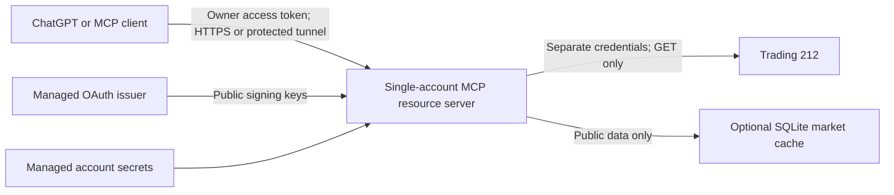

# Private deployment

## Architecture and security boundary

One process, one configured Trading 212 account, twelve read-only tools. Stdio remains the default. HTTP uses FastMCP Streamable HTTP at `/mcp`, stateless protocol sessions and JSON responses; analytical report snapshots remain bounded process-local memory. A shared application runtime owns the account/provider clients across HTTP requests and closes them once on shutdown. Use one worker/replica so account quotas, snapshots and local SQLite ownership remain consistent.



For remote HTTP, this service is an **OAuth resource server**, not an identity provider. Use an established managed OAuth/OIDC issuer with RS256 JWT access tokens. The app validates signature against the explicitly configured HTTPS JWKS, exact issuer, resource audience, expiry, immutable owner subject and `portfolio:read` scope. A valid token for another user/client resource cannot access this account. No identity onboarding, password storage, token issuance or custom consent UI is provided.

Only process probes and standard OAuth protected-resource metadata are public. Missing/invalid authorization gets HTTP 401 before MCP initialization or portfolio retrieval. The challenge advertises `/.well-known/oauth-protected-resource/mcp`. Metadata points to the configured external issuer. Key refreshes are coalesced/rate bounded and cached for five minutes; unavailable/invalid keys fail closed. Signature verification uses PyJWT/cryptography, not custom cryptography. Opaque access tokens, non-RS256 issuers and immediate token introspection/revocation are not implemented.

Use the managed issuer's access policy/MFA to permit only yourself, then configure `MCP_OAUTH_SUBJECT` as an additional application-side owner boundary. Owner identity is **not** inferred from email, MCP arguments, headers supplied by a proxy, or portfolio identifiers.

## Configuration

| Variable | Meaning |
| --- | --- |
| `MCP_TRANSPORT` | `stdio` (default) or `streamable-http` |
| `MCP_HOST` | Bind address, default `127.0.0.1`; containers use `0.0.0.0` with OAuth |
| `MCP_PORT` | Listener port, default 8000; platform `PORT` is used if MCP_PORT is absent |
| `MCP_AUTH_MODE` | `oauth` (default); `local` explicitly allows loopback development only |
| `MCP_PUBLIC_URL` | Exact canonical HTTPS resource URL, ending `/mcp`, no trailing slash/query |
| `MCP_OAUTH_ISSUER` | Exact HTTPS issuer from your provider, including its trailing slash if applicable |
| `MCP_OAUTH_JWKS_URL` | Explicit provider-controlled HTTPS signing-key endpoint |
| `MCP_OAUTH_SUBJECT` | Your immutable issuer `sub`; no wildcard or multi-user allowlist |
| `MCP_OAUTH_SCOPE` | Required scope, default `portfolio:read` |
| `MCP_ALLOWED_HOSTS` | Additional explicit hostnames for platform health checks/ingress, JSON array; canonical public hostname and localhost are included automatically |
| `MCP_ALLOWED_ORIGINS` | Explicit browser origins, JSON array; default local Inspector origins; no wildcard |
| `MCP_SHUTDOWN_SECONDS` | Uvicorn request-draining budget, default 30 seconds |
| `TRADING212_API_KEY`, `TRADING212_API_SECRET` | Server-only secrets; minimum account/portfolio/order/history read permissions |
| `TRADING212_ENVIRONMENT` | `demo` or `live`, default demo; credentials must match |
| `MARKET_RESOLUTION_CACHE_PATH` | Persistent instrument metadata/choices SQLite file |
| `MARKET_CACHE_PATH` | Optional public market-data SQLite cache; unset = memory only |

Remote credentials are read from **process environment only**; HTTP startup does not load the repository's `.env`. For local development `uv run --env-file .env ...` explicitly injects it. Stdio retains its existing local dotenv behaviour. Configuration errors never print input values. Cloud secrets belong in the platform's secret manager/environment, never Docker build arguments, image layers, tool inputs, repository files or OAuth access-token contents.

### Managed OAuth setup (manual)

An Auth0-style managed issuer is a suitable design when its tenant is configured for MCP clients; equivalent infrastructure must meet the same requirements. This repository does not create a tenant or assume any tenant-specific URL/client ID.

1. Register an API/resource identifier equal to your actual `MCP_PUBLIC_URL`; issue RS256 access tokens with audience exactly that resource and scope `portfolio:read`.
2. Restrict login/access to your owner account. Obtain its immutable `sub` securely and set `MCP_OAUTH_SUBJECT` without publishing it in examples.
3. Enable authorization-code + S256 PKCE and the client-registration method your ChatGPT connection supports (managed MCP/CIMD, dynamic registration, or a manually registered client). Configure redirect URIs from the actual client UI/provider instructions; do not guess them.
4. Ensure the issuer publishes standards-compatible authorization-server/OIDC discovery and that its browser authorization/token endpoints are reachable by the client. Our app serves protected-resource metadata; it does not proxy or implement those IdP endpoints.
5. Set the actual issuer/JWKS URLs, public URL and owner subject in the platform configuration. Test the full login/consent/token flow with your tenant before using a live portfolio.

ChatGPT uses OAuth authorization code with PKCE and sends the resulting bearer token to the MCP server. See [OpenAI's authentication requirements](https://developers.openai.com/plugins/build/auth). A static bearer key or browser login page at a reverse proxy is not automatically a compatible OAuth setup.

## Local Inspector

Stdio:

```sh
npx @modelcontextprotocol/inspector uv run --locked trading212-mcp
```

For an editable HTTP connection list, start Inspector without an ad-hoc server/config:

```sh
npx @modelcontextprotocol/inspector
```

Separately run the README's loopback HTTP command, select Streamable HTTP in Inspector, and enter `http://127.0.0.1:8000/mcp`. For the remote protected deployment use its HTTPS URL and configure OAuth using your actual issuer/client registration. Inspector's own proxy/auth token protects Inspector; it is separate from this server's OAuth and Trading 212 credentials. Never disable authentication on a remote server to accommodate Inspector.

Refresh discovery after changing tools; expect twelve. Run account/positions on demo first, then research in summary mode. Full reports/matrices are explicit. Increase the client's request budget where supported; progress messages cannot override an absolute upstream deadline. Cold Yahoo screening may take several minutes: reduce `MARKET_SCREEN_MAX_CANDIDATES`, warm public caches and inspect coverage rather than silently dropping failures. `limit` controls returned results, not scan cost.

## Secure MCP Tunnel

This can keep the server private with **no public inbound endpoint**. It requires a tunnel, runtime API key and appropriate OpenAI organization/workspace permissions; availability is account-dependent. Create/link it in Platform settings and restrict the ChatGPT plugin/workspace access to your intended owner.

Install the supported client using the current [official Secure MCP Tunnel instructions](https://developers.openai.com/api/docs/guides/secure-mcp-tunnels), then inspect `tunnel-client help quickstart`. With real values supplied locally:

```sh
# Set CONTROL_PLANE_API_KEY securely in the process environment; never paste it here.
tunnel-client init --sample sample_mcp_stdio_local --profile trading212-private \
  --tunnel-id "$TUNNEL_ID" \
  --mcp-command "uv run --directory /absolute/path/to/Trading212MCP --locked trading212-mcp"
tunnel-client doctor --profile trading212-private --explain
tunnel-client run --profile trading212-private
```

Keep it running. Stdio's security boundary is the tunnel's authenticated organization/workspace access; use it only when you can restrict that access appropriately. Otherwise use OAuth-protected HTTP end to end. For HTTP profiles the client supports `--mcp-server-url` in place of `--mcp-command`; keep our server in OAuth mode and configure the tunnel/client OAuth flow according to its current help. The authorization server still needs browser reachability.

The documented tunnel request deadline is 120 seconds and progress does not reset it; large cold scans may exceed it. Tunnel access is for private connections, not a substitute for public plugin submission requirements. [Official limits and setup](https://developers.openai.com/api/docs/guides/secure-mcp-tunnels).

## Managed cloud deployment

The generic Docker image is portable to a managed container host. An optional Render configuration is supplied at `deploy/render.yaml`: one instance, persistent `/data`, `/readyz` health checks, environment-only secrets and OAuth-required startup. **Its selected service plan/disk are billed.** Review costs in your own account before importing it; no cloud resources were created. A local machine plus a permitted Secure MCP Tunnel can avoid a separately paid application host.

Manual steps:

1. Choose the platform/account, build this exact checkout/lockfile and configure the actual HTTPS service hostname. Keep one replica and one worker.
2. Create the managed OAuth resource/owner policy above. Supply actual OAuth configuration and Trading 212 read credentials as managed secrets. Start on demo. Do not commit a filled `.env.http` or cloud export.
3. Mount durable storage at `/data` writable by UID/GID **10001**. Existing/bind-mounted/platform disks may need an operator ownership change before startup; the app does not run as root to repair permissions. HTTP startup probes configured cache directories and refuses unwritable paths. Enable optional `MARKET_CACHE_PATH=/data/market-cache.sqlite3` only if desired.
4. Terminate TLS at the platform ingress; make the container listener private to that ingress. Preserve Authorization, Accept, Content-Type and MCP protocol headers. Do not put a custom browser-only login wall in front of OAuth metadata/MCP. Restrict origin/Host allowlists; add an exact platform health hostname only if its checks require one.
5. Configure `/readyz` readiness, `/healthz` liveness, and a platform shutdown grace longer than `MCP_SHUTDOWN_SECONDS`. Disable request-body/header/query logging at proxies. Permit outbound HTTPS to the issuer/JWKS, Trading 212 demo/live, Yahoo, SEC and OpenFIGI; FMP only when selected. Configure Trading 212 IP restrictions if your host provides stable egress.
6. Check health and verify an unauthenticated `POST /mcp` gets 401. Test OAuth discovery/login, then confirm owner tokens work and wrong-user/audience/scope tokens fail. Verify twelve tools and a demo account result before changing to live.
7. Record and deploy a reviewed immutable image digest when publishing images. `uv.lock` locks Python dependencies, not mutable base OS image tags; use verified digest pins for base images if byte-level rebuild reproducibility is required. Rebuild regularly for security updates.

Render's [Blueprint reference](https://render.com/docs/blueprint-spec) describes health/shutdown/disk fields. The example is not a claim that a deployment, domain, managed issuer or ChatGPT connection already exists. No platform API keys, DNS values or cloud credentials are invented here.

## Connect privately in ChatGPT

Using the current ChatGPT UI, open Plugins, add a custom MCP server, and select its actual HTTPS server URL or the configured Tunnel connection. Configure OAuth for protected HTTP, complete your issuer login, and keep the app private. Refresh/discover the twelve tools. Workspace permissions may require an administrator. See [OpenAI's connection instructions](https://developers.openai.com/plugins/deploy/connect-chatgpt).

Validate a demo account summary, positions and one small research call before enabling live-account data. Confirm the displayed source/coverage and use summary mode. This repository supplies an MCP server, not a legacy `ai-plugin.json`, public marketplace submission or custom frontend. Publishing the software later does not publish your configured account; every operator must deploy an isolated single-user instance.

## Storage, health and shutdown

Instrument resolution continues using the existing SQLite metadata/choice cache. Optional market persistence contains only provider responses, uses provider namespaces and hashed lookup keys, and encodes frames as versioned JSON (no pickle/code deserialization). TTLs, capacity bounds and original retrieval timestamps survive restart; reducing the configured TTL also restricts old entries. Corrupt/unwritable market cache entries fall back to memory/provider retrieval, never synthetic data. Provider licensing applies to retained data too.

Account responses, portfolio amounts, OAuth tokens and analytical report snapshots are not persisted by either cache. SDK temporary cookies/caches live under the container's temporary HOME/XDG cache, separate from `/data`. Protect persistent storage from tampering and do not share it between user accounts. SQLite is for a single instance, not a network-shared multi-tenant database.

`/healthz` is process liveness. `/readyz` requires application startup, writable configured cache directories, the shared account client and MCP session manager; it returns 503 before/after that lifecycle. Neither probe calls Trading 212/IdPs/market providers or certifies credentials, market coverage or external service availability. Their bodies contain only a status. On SIGTERM/Ctrl-C, Uvicorn stops accepting work, drains within its configured budget, exits the session manager and closes clients/providers. Synchronous Yahoo work cannot always be cancelled; the platform's final termination deadline remains the hard stop.

## Logging and verification

Logs go to stderr as allowlisted JSON: event/stage, static operation name, duration, generated request ID, HTTP status and response byte count. Account retrieval, instrument resolution, market-provider/cache requests, quantitative functions and SDK result conversion have stage timings. They are observational/nested timings, not additive latency attribution. HTTP duration includes serialization/send overhead; SDK result conversion is measured separately. No additional analytical calculation/rounding is performed for telemetry.

Raw library messages/tracebacks are intentionally replaced by generic events, because they can contain query keys, identifiers or financial data. HTTP access logs are disabled. Logs do not contain tokens, subjects, tool arguments/results, tickers, balances, quantities, IP addresses, URLs or query strings. Platform/IdP logging needs equivalent independent configuration.

Run the README checks and the actual loopback HTTP smoke script. Unit tests use signed synthetic JWTs/local JWKS and mocked financial data; they are not a live IdP/browser OAuth flow. The HTTP smoke uses a real TCP listener and real MCP client without account/provider requests. Container build/startup checks are defined in CI; a local Docker engine is required to run them manually. Cloud provisioning, real OAuth consent, Secure MCP Tunnel permissions and ChatGPT connection remain manual end-to-end validation steps.

## Validation recorded 2026-11-08

- Full pytest: **305 passed, 2 existing live-integration tests skipped**. Existing numerical, twelve-tool and response-mode tests still pass.
- Ruff lint/format and strict Pyright on the local Python 3.14 environment: passed. CI defines runtime tests on Python 3.11/3.12/3.14 and strict typing on 3.14; those remote CI jobs have not been run from this checkout.
- `uv lock --check --offline`: passed, 78 resolved packages. Deployment configuration safeguards: passed. Source distribution and wheel built offline; archive-name checks found no private dotenv, cache, key, database or bytecode files. These are exclusion checks, not a full content/history secrets audit.
- Real TCP loopback HTTP smoke: passed readiness, unauthenticated 401, authenticated MCP initialization/discovery and application shutdown using synthetic credentials/JWKS. A separate CLI child process received real SIGTERM and emitted the cleanup event before exiting. No account/provider requests were made.
- Persistent cache tests cover exact float values, expiry/current TTL, provider namespaces, corrupt data, and timezone/DST preservation.
- **Not verified here:** Docker image build/start (no Docker executable/engine), managed cloud provisioning, real managed-IdP consent/refresh, Secure MCP Tunnel registration and actual ChatGPT connection. All require the operator's platform/domain/permissions; the container build/smoke job is supplied in CI.
- Public distribution still requires the owner's licence/contact decisions and a history-aware secrets review. No cloud resources, OAuth tenant, ChatGPT plugin registration or public endpoint were created.
